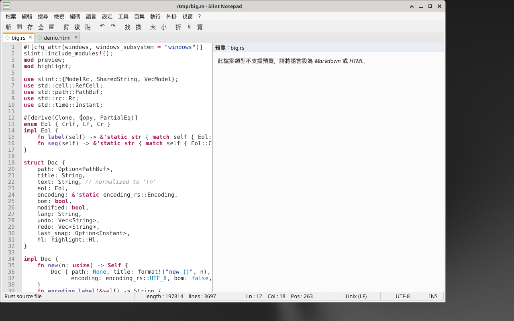

# NotEdit

以 **Rust + [Slint](https://slint.dev)** 製作的類 Notepad++ 文字編輯器，內建簡易 **HTML / Markdown 預覽**。介面為繁體中文。

## 下載

請至 **[Releases 頁面](https://github.com/stevenke1981/notedit/releases/latest)** 下載最新版本：

- Windows：`notedit-windows-x64.zip`（解壓後執行 `notedit.exe`）
- Linux：`notedit-linux-x64.tar.gz`
- macOS (Apple Silicon)：`notedit-macos-arm64.tar.gz`



## 功能

- **拖放**：從檔案總管把檔案拖進視窗即可開啟；分頁可拖曳排序；滑鼠拖曳選取文字
- **選單列**：檔案、編輯、搜尋、檢視、編碼、語言、設定、工具、巨集、執行、外掛、視窗、?
- **工具列**：SVG 圖示（ui/icons）與滑鼠提示
- **多分頁**：分頁顯示修改狀態（● / ○），可點 ✕ 關閉、拖曳排序，Ctrl+Tab 切換
- **檔案**：開新、開啟（多選、命令列、拖放）、重新載入、儲存、另存、全部儲存、關閉 / 全部關閉 / 關閉其他、**最近開啟的檔案**清單、**匯出為 HTML**（含語法上色）、**列印**（以瀏覽器開啟可列印頁面，Ctrl+P）
- **工作階段還原**：重新啟動時自動開回上次的檔案與游標位置（可在「設定」關閉）
- **設定保存**：字型大小、自動換行、行號、預覽、深色主題、巨集、最近檔案、工作階段存於設定檔（Windows：`%APPDATA%\notedit\settings.json`；Linux：`~/.config/notedit/`；macOS：`~/Library/Application Support/notedit/`）
- **編輯**：復原 / 取消復原（Ctrl+Z / Ctrl+Y）、剪下 / 複製 / 貼上 / 全選、複製目前行（Ctrl+D）、刪除目前行、大小寫轉換、移除行尾空白、排序行、**真正的覆寫模式**（Insert 鍵切換，游標變為區塊）
- **搜尋**：尋找 / 取代 / 全部取代、**規則運算式**（支援 `$1` 群組取代）、**全字拼寫須相符**、大小寫須相符、計數、**在所有開啟文件中尋找**（結果面板，點擊跳至該處）、跳至行（Ctrl+G）、跳至對應括號（Ctrl+B）
- **語法上色**：syntect（純 Rust），只渲染可見行並快取解析狀態，數千行檔案仍流暢
- **目前行醒目提示**、**對應括號醒目提示**
- **深色主題**（介面 + 語法配色）
- **巨集**：錄製（Ctrl+Shift+R）/ 播放（Ctrl+Shift+P）/ 重複 10 次，巨集會保存
- **檢視**：行號、自動換行、縮放（Ctrl + + / − / 0）、HTML/Markdown 預覽窗格
- **編碼**：自動偵測（BOM / UTF-8 / chardetng），支援 UTF-8、UTF-8-BOM、UTF-16 LE/BE、Big5、GBK、Shift-JIS、Windows-1252
- **換行格式**：自動偵測 CRLF / LF / CR，可轉換
- **語言**：依副檔名辨識約 19 種語言，可手動切換
- **狀態列**：檔案類型、length / lines、Ln / Col / Pos / Sel、換行格式、編碼、INS/OVR、巨集錄製指示
- **程式圖示**：視窗圖示與 Windows exe 圖示
- **右鍵選單**：編輯區（復原/取消復原、剪下/複製/貼上/刪除、全選、大小寫、複製/刪除行、註解/取消註解 Ctrl+Q、搜尋選取文字、預覽）與分頁（關閉/關閉其他/關閉左側/右側、儲存、另存、重新命名、複製完整路徑/檔名、開啟所在資料夾），不可用項目會變灰
- **字型**：預設為內嵌的 **JetBrains Mono**（SIL OFL 授權），另內嵌 DejaVu Sans Mono；「設定」選單可切換，並自動列出系統已安裝的 Cascadia Code、Consolas、Fira Code、Source Code Pro 等程式字型，選擇會保存。中文字由系統字型自動補字（Windows：微軟正黑體；Linux：Noto Sans CJK）

## 建置

```bash
cargo build --release
./target/release/notedit [檔案...]
```

Linux 需安裝：`libfontconfig1-dev libxkbcommon-dev libwayland-dev libgtk-3-dev`。

推送 `v*` 標籤時，GitHub Actions 會自動建置 Windows / Linux / macOS 並發佈到 Releases。

## 開發路線

NotEdit 會以目前 Notepad++ 的實際能力作為功能對照，而不是只追舊版介面。完整差距、優先級與驗收條件請見 **[Notepad++ parity roadmap](docs/NOTEPADPP_PARITY.md)**。

目前可靠性主線已開始處理「安全儲存」：文件與設定會先寫入同目錄暫存檔並同步到磁碟，再替換目標，避免直接截斷原檔後才開始寫入。

## 已知限制（相較 Notepad++）

- 自動換行模式下改為單色顯示且隱藏行號（語法上色與行號僅在不換行時提供）
- 尚無程式碼摺疊、分割視窗 / 複製檢視、多重選取、自動完成、外掛系統
- 巨集只錄製一般按鍵（文字、方向鍵、Enter、Backspace 等），不含 Shift 選取與選單動作
- 列印透過瀏覽器的列印功能；預覽為簡化版（不支援 CSS、圖片）

## 授權

MIT License，詳見 [LICENSE](LICENSE)。內嵌字型：JetBrains Mono（SIL Open Font License 1.1，`ui/fonts/LICENSE-JetBrainsMono-OFL.txt`）、DejaVu Sans Mono（`ui/fonts/LICENSE-DejaVu.txt`）。
