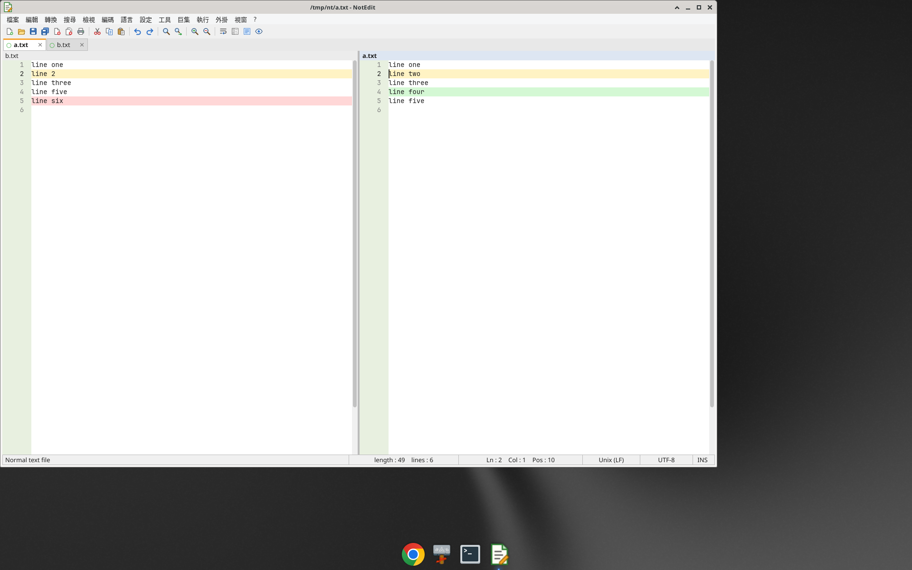
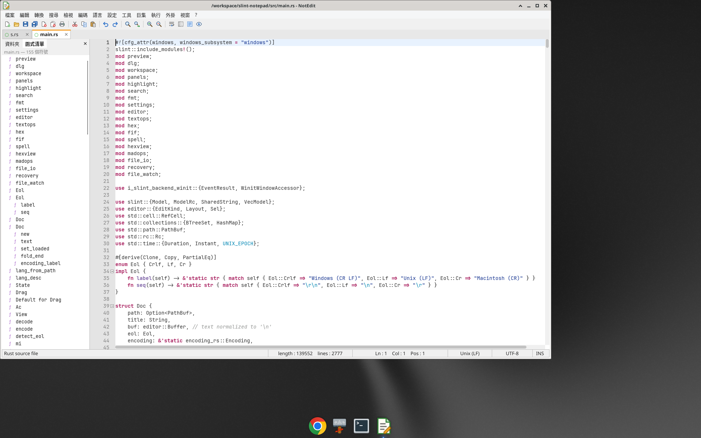

# NotEdit

以 **Rust + [Slint](https://slint.dev)** 製作的類 Notepad++ 文字編輯器，內建簡易 **HTML / Markdown 預覽**。介面為繁體中文。

## 下載

請至 **[Releases 頁面](https://github.com/stevenke1981/notedit/releases/latest)** 下載最新版本：

- Windows：`notedit-windows-x64.zip`（解壓後執行 `notedit.exe`）
- Linux：`notedit-linux-x64.tar.gz`
- macOS (Apple Silicon)：`notedit-macos-arm64.tar.gz`


## 功能

### v0.6.0

- **資料夾工作區**（檔案 → 開啟資料夾作為工作區，檢視 → 資料夾工作區）：左側檔案樹，資料夾優先排序、略過 .git / target / node_modules；按一下展開資料夾、按兩下開啟檔案；工作區與展開狀態會記在設定中
- **函式清單**（檢視 → 函式清單）：Rust、Python、JS/TS、C/C++/C#/Java、Shell、Batch、Markdown 標題、INI/TOML、SQL、CSS、Slint、YAML；按一下跳到該行，清單會標出游標所在的符號
- **分割檢視可顯示不同文件**：右側檢視為作用中時點選分頁，只更換右側文件
- **比較兩個檔案**（工具 → 比較兩個檔案）：以 `similar`（Patience）比對，左右並排標示新增（綠）/ 刪除（紅）/ 修改（黃）的行，F7 / Shift+F7 跳到下一個 / 上一個差異，狀態列顯示統計；編輯後會自動重新比較
- **自訂主題色與快捷鍵**（設定 → 編輯設定檔）：在 `settings.json` 的 `theme_light` / `theme_dark`（例如 `"curline": "#ffe4e4"`）與 `keys`（例如 `"wordcount": "Ctrl+Shift+W"`）中設定，在 NotEdit 中存檔後會立即套用；選單會顯示自訂的快捷鍵
- **Windows 改進**：原生對話框以主視窗為父視窗（modal）；路徑去除 `\\?\` 前綴（含 UNC）；注音 / 倉頡等輸入法在組字中不會被快捷鍵或游標閃爍打斷
- **編譯最佳化**：release 改用 `lto = "fat"`、`codegen-units = 1`、`panic = "abort"`、`strip`；CI 在三個平台執行 `--smoke-test` 啟動測試

| 量測 (Linux x64, 1M 行 / 76.7 MB 檔案) | v0.5.1 | v0.6.0 |
|---|---|---|
| 執行檔大小 | 36.0 MB | 27.8 MB (−23%) |
| 開啟大檔 CPU 時間 | 0.80–0.92 s | 0.76–0.91 s |
| 開啟大檔記憶體 (RSS) | ~263 MB | ~259 MB |
| 開啟小檔記憶體 (RSS) | ~169 MB | ~164 MB |
| 捲動 200 頁 | 無明顯差異（受 xdotool 限制） | 同左 |

自行編譯若只在本機使用，可加上 `RUSTFLAGS="-C target-cpu=native"` 再取得少量效能；發佈版（CI）不使用，以確保在所有 x64 / arm64 CPU 上都能執行。




### v0.5.1

- **在檔案中取代改為背景執行**：掃描與寫入都在背景執行緒進行，對話框即時顯示「掃描中… 已檢查 N 個檔案」/「寫入中… i / N」，可按「停止」中斷（已寫入的檔案仍可用「復原檔案取代」以 .bak 還原），視窗全程可操作
- 開啟任何對話框前會先關閉已展開的選單 / 右鍵選單
- 右鍵點擊會先把游標移到點擊位置（點在選取範圍內則保留選取），拼字建議對應到正確的單字
- 閒置約 10 秒後游標停止閃爍，閒置 CPU 降到 0%
- 過濾 macOS/私用區功能鍵字元與控制字元，避免誤插入文件

### v0.5.0

- **在檔案中取代**（搜尋 → 在檔案中取代）：資料夾、檔案類型篩選、子資料夾、規則運算式（取代字串可用 `$1` 群組）；「預覽」先在結果面板列出所有符合處，「全部取代」會列出檔案與次數並要求確認後才寫入；已開啟的文件只在編輯器中修改（Ctrl+Z 可復原，尚未存檔），其他檔案先備份為 `.bak` 再寫入，保留原本的編碼、BOM 與換行符號，可用「復原檔案取代」一鍵還原；略過二進位檔與超過 64 MB 的檔案
- **JSON / XML 格式化與壓縮**（轉換選單）：保留鍵的順序與內容；格式錯誤時顯示行號與欄號（例如「JSON 格式錯誤：第 3 行，第 6 欄」、「</a> 與第 2 行的 <b> 不對應」）；有選取時只處理選取範圍
- **打字機模式**（設定 → 打字機模式）：游標所在行保持在視窗垂直中央
- **修改標記**：復原 / 取消復原回到上次存檔的內容時，分頁與標題列的修改標記會自動清除
- 自動完成清單開啟時按右鍵，會關閉清單並正常顯示右鍵選單
- **閒置 CPU 降低**：沒有變化時停止 30 ms 更新計時器，游標改用 Slint 內建的閃爍游標，不再有額外的重繪計時器（在無 GPU 的軟體繪圖環境中，閒置 CPU 由約 12% 降到約 6%；有 GPU 時幾乎為 0）
- 自動備份 / 當機還原：未存檔的文件會定期寫入還原日誌，異常結束後再次啟動時可還原

### v0.4.0：MadEdit 功能

參考 [MadEdit](https://sourceforge.net/projects/madedit/) / [MadEdit-Mod](https://github.com/LiMinggang/MadEdit-Mod) 加入：

- **十六進位模式**（檢視 → 十六進位模式，Alt+H）：位移欄、16 位元組十六進位欄與 ASCII 欄；Tab 在兩欄間切換；直接輸入十六進位數字或字元覆寫位元組，Insert 切換插入 / 覆寫，Delete / Backspace 刪除位元組；Shift+方向鍵或拖曳選取，Ctrl+C 複製為十六進位字串、Ctrl+V 貼上十六進位字串；獨立的復原 / 取消復原；可隨時切回文字模式
- **大檔案 / 二進位檔**：偵測為二進位的檔案直接以十六進位模式開啟；超過 512 MB 的檔案以記憶體映射（mmap）開啟，只讀取可見範圍（600 MB 檔案約 1 秒內開啟，可覆寫位元組並儲存）；140 MB 文字檔可直接以文字模式編輯
- **欄模式**（檢視 → 欄模式，Alt+C）：一般拖曳與 Shift+方向鍵即為矩形選取
- **轉換選單**：繁體 ↔ 簡體（OpenCC 詞彙轉換，如「軟體 ↔ 软件」）、全形 ↔ 半形、Tab ↔ 空白、字首大寫、大小寫互換、移除行首（及行尾）空白、合併行、刪除空行（含只有空白的行）、遞減排序、移除重複行、插入遞增數字、欄位對齊、複製為十六進位字串 / 還原十六進位字串（接受 `4D6F64`、`4D 6F 64`、`%4D%6F%64`、`4D,6F,64`）；有選取時只轉換選取範圍
- **字數統計**（工具 → 字數統計）：中日韓文字每字計一個字，另列字元、空白、中日韓、半形 / 全形、行數、位元組
- **在檔案中尋找**（搜尋 → 在檔案中尋找，Ctrl+Shift+F）：資料夾、檔案類型篩選（`*.rs;*.md`）、包含子資料夾、規則運算式 / 大小寫 / 全字；背景執行可停止，結果即時加入結果面板，點擊即開啟檔案並跳至該處（略過 .git、target、node_modules 與二進位檔）
- **拼字檢查**（檢視 → 拼字檢查）：內建 en_US Hunspell 字典（spellbook），純文字 / Markdown 中錯字加紅色底線，右鍵選單提供建議字與「忽略」（忽略清單會保存）

### 既有功能

- **自製編輯器元件（v0.3.0）**：以 ropey 作為文字緩衝區，自行排版、繪製與處理輸入（不再疊加 TextInput），大檔案（10 MB / 20 萬行）仍可流暢捲動與編輯；游標閃爍、IME 輸入法支援
- **自動換行**：換行時仍保留語法上色與行號
- **程式碼摺疊**：依括號或縮排判斷區塊，行號旁有摺疊邊界（⊟ / ⊞），Alt+0 全部摺疊、Alt+Shift+0 全部展開、Ctrl+Alt+F 摺疊目前區塊
- **分割檢視**：「檢視 → 分割檢視」把目前文件複製到第二個檢視，兩邊同步編輯、各自捲動；F8 切換檢視
- **多重游標**：Ctrl+點擊新增游標、Alt+拖曳欄選取（Alt+Shift+方向鍵亦可）、同時輸入 / 刪除 / 貼上，一次復原
- **自動完成**：文件中的單字與語言關鍵字，輸入 2 個字元後出現（Ctrl+Space 手動開啟，可在「設定」關閉）
- **書籤**：Ctrl+F2 切換、F2 / Shift+F2 跳至下一個 / 上一個，點擊行號邊界亦可
- **標記所有相同字**：選取單字時，文件中相同的字會一併醒目提示
- **文件地圖**：「檢視 → 文件地圖」顯示整份文件縮圖與目前可視範圍，點擊即可跳轉
- **TOML 語法上色**
- **拖放**：從檔案總管把檔案拖進視窗即可開啟；分頁可拖曳排序；滑鼠拖曳選取文字
- **選單列**：檔案、編輯、搜尋、檢視、編碼、語言、設定、工具、巨集、執行、外掛、視窗、?
- **工具列**：SVG 圖示（ui/icons）與滑鼠提示
- **多分頁**：分頁顯示修改狀態（● / ○），可點 ✕ 關閉、拖曳排序，Ctrl+Tab 切換
- **檔案**：開新、開啟（多選、命令列、拖放）、重新載入、儲存、另存、全部儲存、關閉 / 全部關閉 / 關閉其他、**最近開啟的檔案**清單、**匯出為 HTML**（含語法上色）、**列印**（以瀏覽器開啟可列印頁面，Ctrl+P）
- **工作階段還原**：重新啟動時自動開回上次的檔案與游標位置（可在「設定」關閉）
- **設定保存**：字型大小、自動換行、行號、預覽、深色主題、巨集、最近檔案、工作階段存於設定檔（Windows：`%APPDATA%\notedit\settings.json`；Linux：`~/.config/notedit/`；macOS：`~/Library/Application Support/notedit/`）
- **編輯**：復原 / 取消復原（Ctrl+Z / Ctrl+Y）、剪下 / 複製 / 貼上 / 全選、複製目前行（Ctrl+D）、刪除目前行、大小寫轉換、移除行尾空白、排序行、**真正的覆寫模式**（Insert 鍵切換，游標變為區塊）
- **搜尋**：尋找 / 取代 / 全部取代、**規則運算式**（支援 `$1` 群組取代）、**全字拼寫須相符**、大小寫須相符、計數、**在所有開啟文件中尋找**（結果面板，點擊跳至該處）、跳至行（Ctrl+G）、跳至對應括號（Ctrl+B）
- **語法上色**：syntect（純 Rust），以時間預算增量解析並只繪製可見行，大檔案仍流暢
- **目前行醒目提示**、**對應括號醒目提示**
- **深色主題**（介面 + 語法配色）
- **巨集**：錄製（Ctrl+Shift+R）/ 播放（Ctrl+Shift+P）/ 重複 10 次，會錄製文字、方向鍵 / Shift 選取、Ctrl 快速鍵與選單動作，巨集會保存
- **檢視**：行號、自動換行、縮放（Ctrl + + / − / 0）、HTML/Markdown 預覽窗格
- **編碼**：自動偵測（BOM / UTF-8 / chardetng），支援 UTF-8、UTF-8-BOM、UTF-16 LE/BE、Big5、GBK、Shift-JIS、Windows-1252
- **換行格式**：自動偵測 CRLF / LF / CR，可轉換
- **語言**：依副檔名辨識約 19 種語言，可手動切換
- **狀態列**：檔案類型、length / lines、Ln / Col / Pos / Sel、換行格式、編碼、INS/OVR、巨集錄製指示
- **程式圖示**：視窗圖示與 Windows exe 圖示
- **右鍵選單**：編輯區（復原/取消復原、剪下/複製/貼上/刪除、全選、大小寫、複製/刪除行、註解/取消註解 Ctrl+Q、搜尋選取文字、預覽）與分頁（關閉/關閉其他/關閉左側/右側、儲存、另存、重新命名、複製完整路徑/檔名、開啟所在資料夾），不可用項目會變灰
- **字型**：預設為內嵌的 **JetBrains Mono**（SIL OFL 授權），另內嵌 DejaVu Sans Mono；「設定」選單可切換，並自動列出系統已安裝的 Cascadia Code、Consolas、Fira Code、Source Code Pro 等程式字型，選擇會保存。中文字由系統字型自動補字（Windows：微軟正黑體；Linux：Noto Sans CJK）

## 建置

```bash
cargo build --release
./target/release/notedit [檔案...]
```

Linux 需安裝：`libfontconfig1-dev libxkbcommon-dev libwayland-dev libgtk-3-dev`。

推送 `v*` 標籤時，GitHub Actions 會自動建置 Windows / Linux / macOS 並發佈到 Releases。

## 開發路線

NotEdit 會以目前 Notepad++ 的實際能力作為功能對照，而不是只追舊版介面。完整差距、優先級與驗收條件請見 **[Notepad++ parity roadmap](docs/NOTEPADPP_PARITY.md)**。

目前可靠性主線已開始處理「安全儲存」：文件與設定會先寫入同目錄暫存檔並同步到磁碟，再替換目標，避免直接截斷原檔後才開始寫入。

## 已知限制（相較 Notepad++）

- 尚無外掛系統；資料夾工作區尚不支援新增 / 重新命名 / 刪除檔案；函式清單以規則運算式擷取（非完整語法分析）
- 比較檔案時不會插入對齊用的空白行，兩側捲動不同步（F7 會同時移動兩側到對應差異）
- 快捷鍵與主題沒有圖形設定對話框，需編輯 settings.json
- 十六進位模式下，記憶體映射的大型檔案只能覆寫位元組（不能插入 / 刪除）；拼字檢查僅英文，且只檢查純文字 / Markdown
- 尚未加入 MadEdit 的 Python 巨集、書籤行的複製 / 剪下
- XML 格式化為輕量實作，不驗證 DTD / 命名空間
- 編輯器以等寬字格排版；比例字型或連字（ligature）不會依實際寬度顯示
- 列印透過瀏覽器的列印功能；預覽為簡化版（不支援 CSS、圖片）

## 授權

MIT License，詳見 [LICENSE](LICENSE)。拼字字典 en_US 來自 SCOWL / wooorm/dictionaries（`assets/dict/LICENSE-en_US.txt`）；繁簡轉換使用 ferrous-opencc（Apache-2.0）。內嵌字型：JetBrains Mono（SIL Open Font License 1.1，`ui/fonts/LICENSE-JetBrainsMono-OFL.txt`）、DejaVu Sans Mono（`ui/fonts/LICENSE-DejaVu.txt`）。
